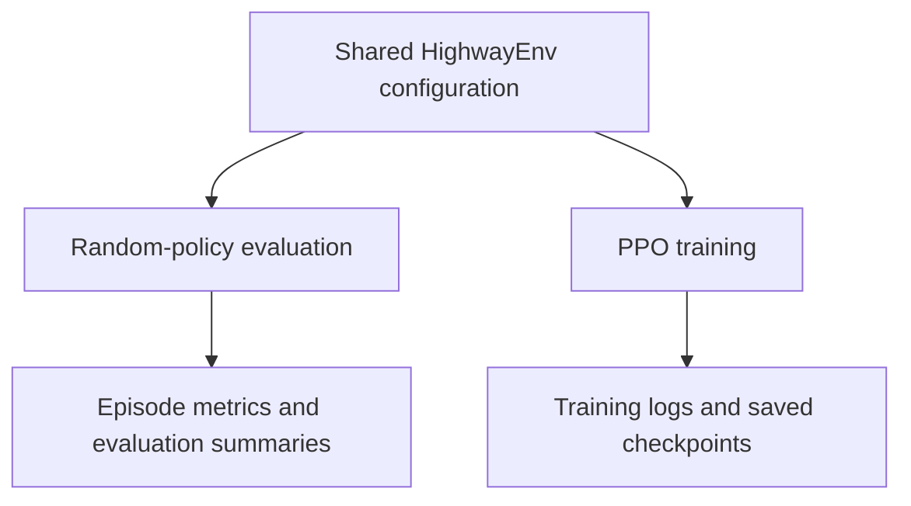

# Deep RL Generalization in Simulated Driving
### How well do driving policies handle traffic conditions they were not trained on?

**Ongoing ECE1508H reinforcement learning project · University of Toronto**

## Project Overview

A driving policy trained in one traffic setting may struggle when the number of nearby vehicles or their driving behavior changes. This project investigates how the choice of training scenarios affects a reinforcement learning agent's performance under unfamiliar traffic conditions.

We use PPO in HighwayEnv to study two questions:

1. Does varying traffic conditions along one dimension, such as vehicle count, help a policy handle changes in another, such as surrounding-vehicle driving style?
2. How do uniform sampling, adaptive sampling, and curriculum learning affect generalization to unseen scenarios?

The initial simulator setup, random-policy baseline, and first PPO training pilot are complete. Independent PPO evaluation and out-of-distribution (OOD) experiments are the next stages.

All experiments take place in simulation.

## Current Progress

| Component | Status |
| --- | --- |
| HighwayEnv setup and environment smoke tests | Completed |
| Shared episode metrics and CSV logging | Completed |
| Random-policy evaluation: 100 episodes | Completed |
| Initial PPO training: 50,176 environment steps | Completed |
| Independent PPO evaluation | Next stage |
| Matched Random vs PPO evaluation | Pending |
| Configurable vehicle-count and driving-style scenarios | Planned |
| Cross-factor generalization experiments | Planned |
| Uniform, adaptive, and curriculum sampling comparison | Planned |

## Simulator and Agent

The current baseline uses `highway-v0` with:

| Setting | Configuration |
| --- | --- |
| Road | Four lanes |
| Background traffic | 20 IDM vehicles |
| Observation | Kinematic features |
| Action space | Five discrete driving actions |
| Episode time limit | 30 simulated seconds |
| Reward | HighwayEnv default reward configuration |
| Learning algorithm | PPO, using Stable-Baselines3 `MlpPolicy` |

The ego vehicle is the learning agent. Its actions control lane changes and speed adjustments while interacting with surrounding traffic.

Vehicle count is a controllable proxy for traffic density. Future scenario validation will check that changes in vehicle count and driving style produce the intended differences in simulated traffic.

## Implemented Workflow

The environment factory and shared metric definitions will also support independent PPO evaluation and later scenario comparisons.

## Initial Results

### Random Policy: Independent Evaluation

The random policy was evaluated over 100 episodes using seeds 42–141 in the fixed baseline environment.

| Metric | Result |
| --- | ---: |
| Mean episode reward | 10.151 |
| Episode reward standard deviation | 6.403 |
| Collision rate | 93.0% |
| Collision-free completion rate | 7.0% |
| Mean ego-vehicle speed | 23.907 m/s |
| Mean episode length | 13.36 decision steps |

Collision-free completion means surviving until the configured time limit; it does not mean reaching a geographic destination.

### PPO Pilot: Training Progress

The first PPO pilot used CPU training, seed 42, and a nominal budget of 50,000 environment steps. It completed **50,176 steps** across **1,842 completed training episodes** and saved a final policy checkpoint.

| Training window | Mean episode reward | Mean episode length |
| --- | ---: | ---: |
| First 100 completed training episodes | 11.02 | 14.79 steps |
| Last 100 completed training episodes | 19.63 | 27.23 steps |

These training summaries show learning progress during the pilot. Independent evaluation is still required to measure the trained policy's collision rate, completion rate, and performance on unseen scenarios.

The PPO training summaries and random-policy evaluation results are different measurements and are not presented as a matched policy comparison.

## Planned Generalization Study

### Cross-Factor Generalization

The first research phase will compare four training conditions:

| Training condition | Vehicle count | Background driving style |
| --- | --- | --- |
| Fixed baseline | Fixed | Fixed |
| Vehicle-count randomization | Varied | Fixed |
| Driving-style randomization | Fixed | Varied |
| Joint randomization | Varied | Varied |

Policies will then be evaluated under changes in vehicle count, driving style, and both factors together. This will test whether exposure to one source of variation helps with another.

### Training Scenario Selection

Using a common scenario pool, the second phase will compare:

- **Uniform sampling:** Select training scenarios with equal probability.
- **Adaptive sampling:** Adjust scenario selection using training-monitor feedback.
- **Curriculum learning:** Change the training scenario distribution over time according to a defined schedule.

Comparisons will use matched environment interaction budgets and multiple training seeds. Evaluation will consider collision-free completion, speed, return, learning efficiency, and the performance gap between familiar and unfamiliar conditions.

## Next Milestones

1. Implement independent PPO evaluation using the existing environment factory and episode metrics.
2. Evaluate Random and PPO under identical conditions using a held-out evaluation seed set.
3. Implement and validate configurable vehicle-count and driving-style scenarios.
4. Define separate training, monitoring, validation, and final test scenarios.
5. Run the cross-factor and sampling experiments, reporting variation across runs.

The existing random baseline seed range overlaps the training seed range. Formal comparisons will therefore rerun both policies on a separate held-out evaluation seed set.

## Technical Focus

- **Experiment engineering:** Reusable simulator configuration, shared metrics, checkpoints, and episode-level logging.
- **Deep reinforcement learning:** PPO policy training with Stable-Baselines3.
- **Evaluation design:** Separating training diagnostics from independent policy evaluation.
- **Generalization research:** Controlled traffic variations, scenario sampling, and OOD testing.

**Tools:** Python, Gymnasium, HighwayEnv, Stable-Baselines3, PyTorch, and TensorBoard.

## Scope and Limitations

The current milestone establishes a working training and measurement pipeline. No OOD experiments have been completed, and the pilot does not yet demonstrate improved robustness from traffic randomization or scenario sampling.

The project studies generalization within HighwayEnv. It does not establish real-world autonomous driving performance or sim-to-real transfer.

## Source Code and Artifacts

This repository provides a public overview of the project, its initial results, and planned experiments. The full implementation is maintained in a private repository.

Trained policy checkpoints, raw episode logs, and full experiment outputs are not distributed in this showcase.

